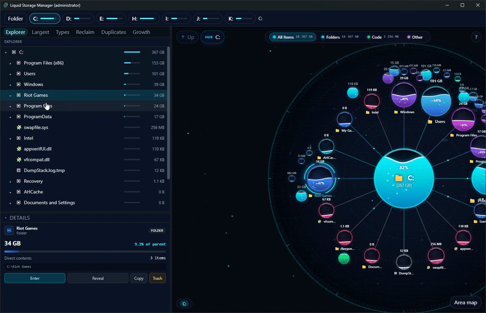
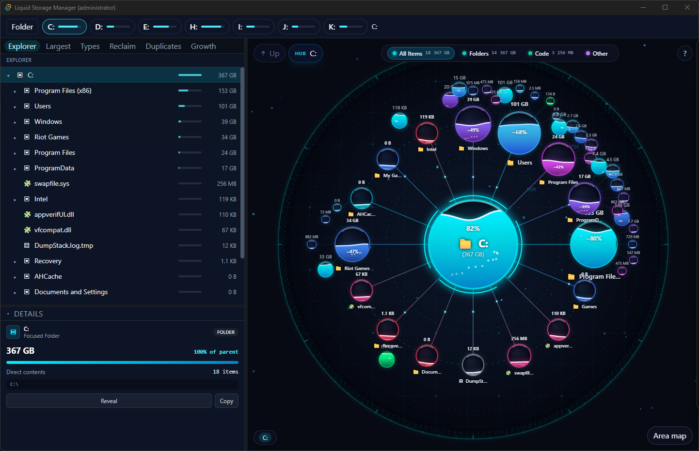
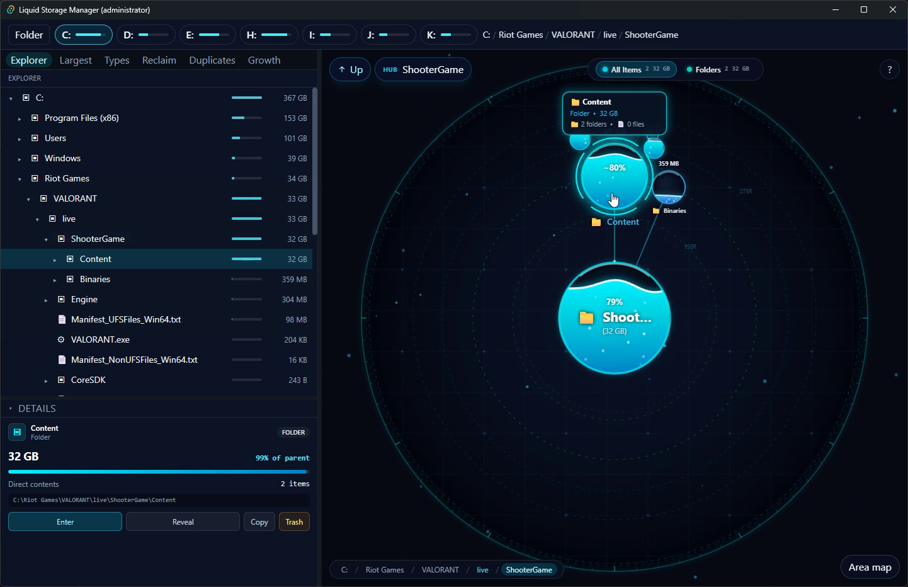
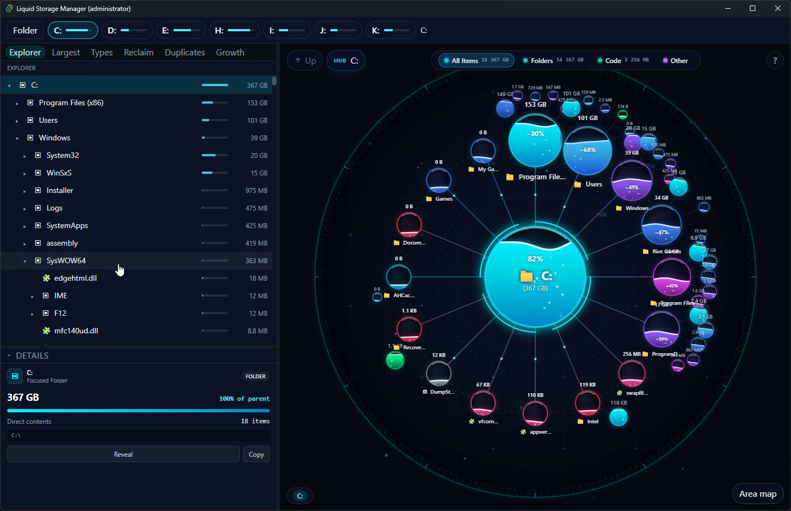
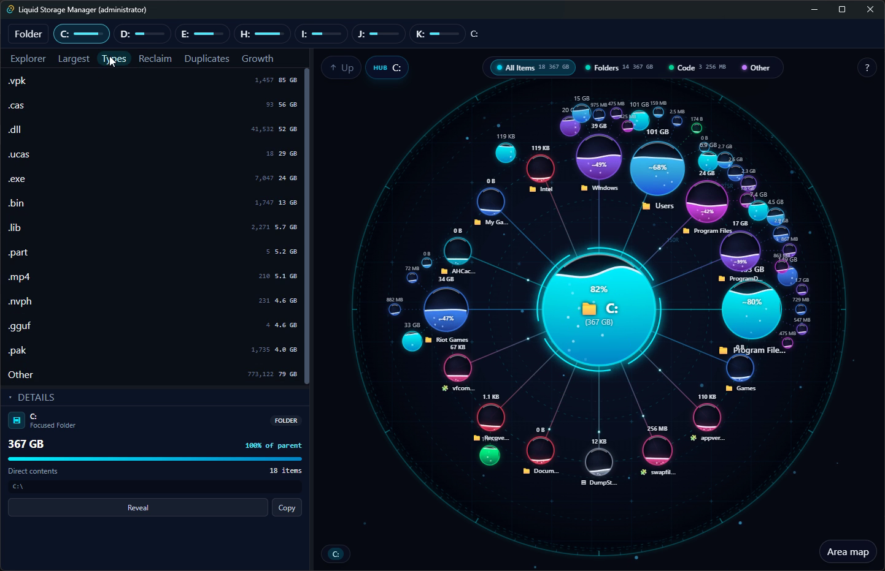
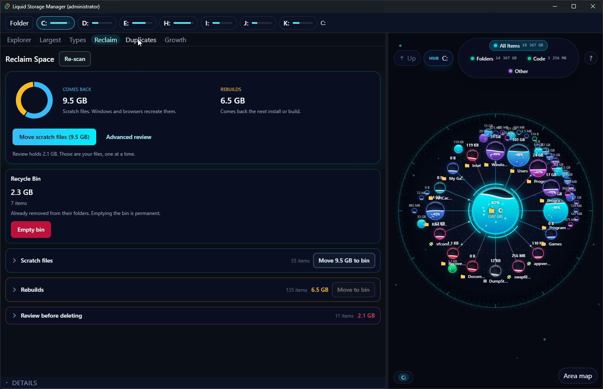
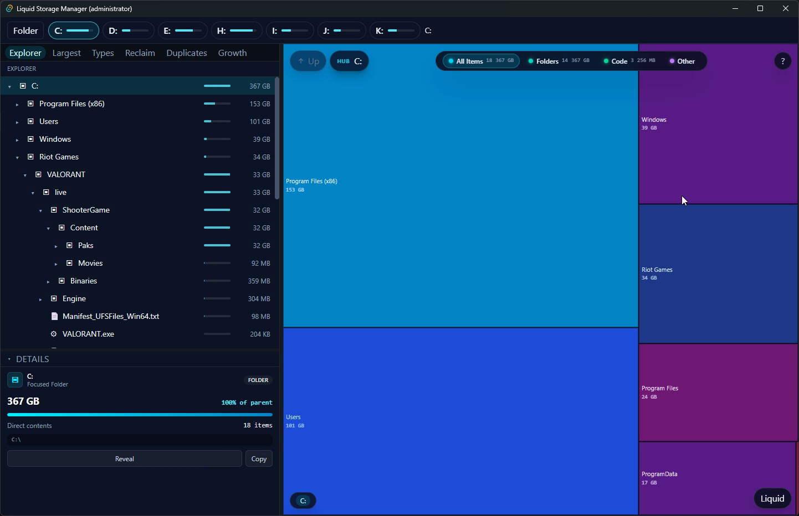
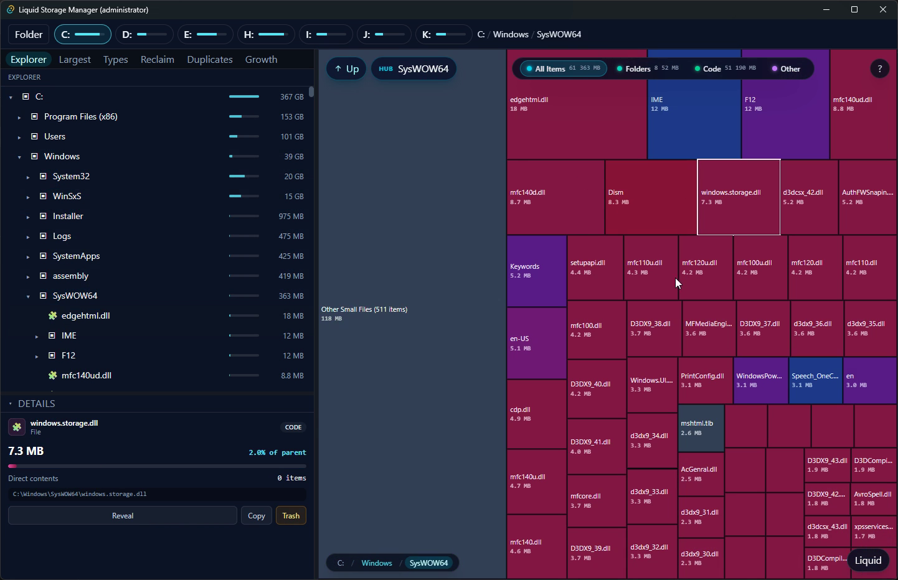

# Liquid Storage Manager

A Windows disk map. The scan stays in Rust. The window shows a size-sorted folder tree and a liquid view of the folder you are in.

**Platform:** Windows only (x64). Linux and macOS are not supported.

**MSRV:** Rust 1.85 (edition 2024).

**License:** [MIT](LICENSE) © 2026 Dip Chowdhury.

[Download for Windows](https://github.com/dipbd1/rust-disk-management/releases/latest) · [Demo video](docs/media/demo.mp4)

<!--
  Inline README video (optional):
  GitHub only plays videos inline in a README when they are hosted as user-attachments.
  Drag docs/media/demo.mp4 into a GitHub issue/PR comment, copy the resulting
  https://github.com/user-attachments/... URL, and paste that URL alone on the next line
  (replacing this comment block) for an inline player.
-->



## Screenshots

<table>
  <tr>
    <td align="center" width="50%">
      <a href="docs/media/01-bubble-map.png"></a><br />
      <em>Map — liquid bubble view of C:</em>
    </td>
    <td align="center" width="50%">
      <a href="docs/media/05-drill-down.png"></a><br />
      <em>Map — drill into a folder</em>
    </td>
  </tr>
  <tr>
    <td align="center" width="50%">
      <a href="docs/media/02-explorer.png"></a><br />
      <em>Explorer — size-sorted folder tree</em>
    </td>
    <td align="center" width="50%">
      <a href="docs/media/03-types.png"></a><br />
      <em>Types — top extensions by bytes</em>
    </td>
  </tr>
  <tr>
    <td align="center" width="50%">
      <a href="docs/media/04-reclaim.png"></a><br />
      <em>Reclaim — scratch files, rebuilds, and the bin</em>
    </td>
    <td align="center" width="50%">
      <a href="docs/media/06-area-map.png"></a><br />
      <em>Area map — treemap of C:</em>
    </td>
  </tr>
  <tr>
    <td align="center" colspan="2">
      <a href="docs/media/07-area-map-detail.png"></a><br />
      <em>Area map — Windows\SysWOW64 in detail</em>
    </td>
  </tr>
</table>

## Install

### Direct download

Download the MSI or NSIS installer from [GitHub Releases](https://github.com/dipbd1/rust-disk-management/releases). Prefer a published release over a draft when both exist.

- NSIS: `Liquid.Storage.Manager_<ver>_x64-setup.exe`
- MSI: `Liquid.Storage.Manager_<ver>_x64_en-US.msi`

Installed builds can check for updates from the latest published release (About → Check for updates, or the startup prompt). Signing setup and release steps are in [RELEASING.md](RELEASING.md).

There is no crates.io package and no CLI; this is a desktop app.

### WinGet

Once the package is accepted into the [Windows Package Manager Community Repository](https://github.com/microsoft/winget-pkgs):

```powershell
winget install dipbd1.LiquidStorageManager
```

Manifests live in [`packaging/winget/`](packaging/winget/). The first submission is manual; later published releases can open a `winget-pkgs` PR via Actions when the `WINGET_TOKEN` secret is set. See [`packaging/README.md`](packaging/README.md).

### Scoop

```powershell
scoop install https://raw.githubusercontent.com/dipbd1/rust-disk-management/main/packaging/scoop/liquid-storage-manager.json
```

Or copy [`packaging/scoop/liquid-storage-manager.json`](packaging/scoop/liquid-storage-manager.json) into a custom Scoop bucket’s `bucket/` folder, then `scoop install liquid-storage-manager`. The manifest uses GitHub `checkver` and `autoupdate`.

### Admin / UAC

An elevated process can read the NTFS Master File Table for a faster full-drive scan. If you are not elevated and a fixed NTFS drive is present, the app asks once whether to restart as administrator. Declining still works: it walks the folder tree instead. You can start a faster elevated scan later from the top bar.

## Scan

The top bar lists mounted drives. Choose one to scan it. **Folder** opens a folder and scans that path instead.

An elevated scan of an NTFS drive root reads the Master File Table. Every other scan walks the folder with `FindFirstFileEx`. Hidden files are included. Symlinks and reparse points are not followed. `System Volume Information` and `$Recycle.Bin` are not descended.

If the app is not elevated and a fixed NTFS drive is present, it asks once whether to restart as administrator. A folder walk still works if you continue. **Faster scan** restarts the debug session elevated (`npm run dev:admin` does the same). Stop any other dev session first; both need port 1420.

Cancel keeps the partial index. Rescan starts again from the active drive or folder.

## What the panes do

The left pane tabs are Explorer, Largest, Search, Types, Reclaim, Duplicates, Growth, and Deleted.

- **Largest** pages files by size. Choosing one selects it and focuses its parent in the graph.
- **Search** matches names anywhere in the scan. Those results are not the tree.
- **Types** shows the top 12 extensions by bytes, plus Other. Choosing one opens that file list.
- **Growth** compares this finished scan with the last snapshot of the same root: folders that grew, and large files that are new or bigger. Each row shows a folder or file icon, the parent path, the increase, and the current size. The list sorts by growth, size, or kind.

The right pane is the liquid graph of the focused folder: at most 60 children, plus one aggregate for the rest. **Area map** draws those same nodes as a squarified map. Liquid stays the default. A click selects. A double click opens a folder.

## Safety

Deletes are meant to feel reversible for early use:

- **Recycle Bin by default.** Delete, Trash, and cleanup actions move items to the Recycle Bin. Permanent delete is opt-in (Shift+Delete or the context-menu item) and needs an extra acknowledgment.
- **Preview before delete.** Confirms list the items, the count, the total size, and whether they go to the Recycle Bin or are removed for good.
- **Protected paths.** Drive roots, `\Windows\`, `\Program Files\`, and `\Program Files (x86)\` are refused by the backend even if a confirm is skipped.
- **Recent deletions.** The Deleted tab logs what this app removed and offers Restore when the Recycle Bin still has the item, or Open Recycle Bin otherwise.

## Cleanup rules

Delete asks with that preview, then moves the selection to the Recycle Bin and reports the freed bytes. Shift+Delete asks before permanent delete. Clicking the drive that is already the scan root returns to that root and does not start another walk.

**Reclaim** lists only catalog matches, each with a sentence:

- **Safe** — user Temp, Windows Temp, Windows Update downloads, Delivery Optimization, thumbnail caches, and browser caches. One confirm recycles that group.
- **Rebuilds** — `node_modules`, npm cache, pip cache, the Cargo registry, and Steam shader caches that are not under a protected folder. The tools recreate them. Same confirm.
- **Review** — `Windows.old`, Downloads files of at least 100 MiB older than 30 days, and Docker or WSL virtual disks. One item at a time.
- **System** — `hiberfil.sys` and `pagefile.sys` are explained and cannot be deleted here. Recycle Bin size is read from Windows. Emptying the bin is a separate confirm and uses the Recycle Bin API.

Nothing under `\Windows\` is recycled except the named safe caches above. Nothing under `\Program Files\` or `\Program Files (x86)\` is recycled. There is no “clean everything.”

**Duplicates** does not run during a scan. You start it. It hashes files of at least 1 MiB that share a size, skips hard links, cloud-only files, and protected paths (with no Windows-cache exception), and keeps one copy. Recycling the others is a confirm. At most 100 groups are shown.

## Develop

```bash
npm install
npm run tauri dev
```

The debug build also serves the UI at `http://localhost:1420` through the remote command socket. Release builds do not open that socket.

```bash
cargo test --manifest-path src-tauri/Cargo.toml
npx tsc --noEmit
```

The identifier stays `com.anarchy.disk-space-management`, so existing app data paths stay put. Optional Authenticode and updater signing use repository secrets on the Release workflow; unsigned installers still build when those secrets are absent (updater artifacts are skipped). A store listing is outside this repo.

See [CHANGELOG.md](CHANGELOG.md) for release notes and [RELEASING.md](RELEASING.md) for the full checklist (`release/X.Y.Z` branch, version bump script, tag, signed updater draft, WinGet/Scoop).
